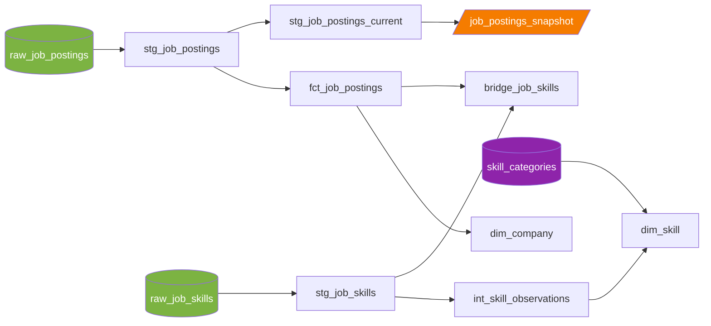

# 🔧 DBT Data Engineering — Portfolio Monorepo

[](https://github.com/2MOData/DBT-Data-Engineering/actions/workflows/dbt_build.yml)
[](https://2modata.github.io/DBT-Data-Engineering/)


Two end-to-end **analytics engineering** pipelines built with **dbt**, on a year of real, messy job-posting data (Data Engineer / Analyst / Scientist roles).

The same dataset goes through two levels of maturity:

| | Project 1 — Foundations | Project 2 — Production |
| --- | --- | --- |
| **Warehouse** | DuckDB (local, file-based) | Databricks + Unity Catalog |
| **Modeling** | sources → cleaned model → insight marts | medallion layers → star schema (fact, dims, bridge) |
| **Loading** | full rebuild (`table`) | incremental `merge` + SCD2 snapshots |
| **Orchestration** | GitHub Actions (on push + weekly) | scheduled Databricks Job |
| **Publishing** | warehouse as a GitHub Release, docs on Pages | docs in Unity Catalog (`persist_docs`) and on Pages |
| **Code & docs** | [`project_1/`](project_1/) · [dbt docs](https://2modata.github.io/DBT-Data-Engineering/project_1/) | [`project_2/`](project_2/) · [dbt docs](https://2modata.github.io/DBT-Data-Engineering/project_2/) |

---

## 🧠 What this repo demonstrates

### dbt modeling
- **Declared sources**: `source()` everywhere, no hardcoded paths or table names in SQL
- **Layered architecture**: staging (views) → intermediate (views) → marts (tables), each layer configured per folder in `dbt_project.yml`
- **Dimensional modeling**: a star schema with a declared grain: `fct_job_postings`, `dim_company`, `dim_skill`, and a `bridge_job_skills` table for the many-to-many relationship between jobs and skills
- **Materializations**: `view`, `table`, `ephemeral` and `incremental`, each chosen for a reason
- **Incremental loads**: `merge` on `job_id` with `is_incremental()` and a date high-water mark, so only new days are processed
- **SCD Type 2 snapshots**: `check` strategy over 13 business columns to keep the full change history of each posting (salary edits, title changes…), plus a one-shot SQL backfill of a year of history
- **Seeds**: a version-controlled skill taxonomy (`skill_categories.csv`)
- **Analyses**: business questions kept next to the models that answer them

### Jinja & macros
- **Custom macros**: `parse_salary()` turns free-text salaries into numbers, written once and reused; `slugify()` builds clean column names
- **Jinja loops**: benefit flags (`has_health_insurance`, `has_paid_time_off`…) generated from a keyword list, so one edit adds a column
- **Overriding a dbt built-in**: `generate_schema_name` so schemas land exactly where the folder says
- **Project variables**: `var('as_of')` to rebuild the "current" view of the data as of any date
- **Packages**: `dbt_utils` installed with `dbt deps`

### Data quality & testing
- **Generic tests**: `unique`, `not_null`, `accepted_values`, `relationships` (referential integrity between fact and dimensions)
- **Custom generic test**: `non_negative`, written as a reusable `` block
- **Singular test**: `assert_salaries_sane`, a business rule that schema tests can't express
- **Severity levels**: `warn` vs `error`, so known data issues are documented rather than hidden
- **Test-driven cleaning**: tests first surface real data problems, then each one is fixed or documented on purpose
- `dbt build` runs models **and** tests in DAG order: a failing test stops everything downstream of it

### CI/CD & DevOps
- **GitHub Actions**: install dependencies → download raw data → `dbt build` → publish the DuckDB warehouse as a release asset; triggered on push, every Monday (cron) and manually
- **Path filters**: in the monorepo, the workflow only runs when `project_1/` changes
- **Environments**: `dev` vs `prod` targets (DuckDB) and `dev` vs `prod` catalogs (Databricks); prod is written only by automation
- **No secrets in the repo**: CI profile committed without credentials, CI uses the built-in `GITHUB_TOKEN`
- **Reproducible environments**: `uv` with `pyproject.toml`, `uv.lock` and a pinned `.python-version` per project
- **GitHub Pages**: one site hosting the dbt docs of both projects

### Databricks
- **Unity Catalog**: `raw`, `dev` and `prod` catalogs with schemas per layer (`staging`, `intermediate`, `marts`, `snapshots`, `seeds`)
- **EL step in a notebook**: `load_raw.py` downloads the dataset into a **Unity Catalog Volume** and lands it as bronze tables
- **Delta Lake**: table history (`DESCRIBE HISTORY`) and time travel to check what each incremental run actually did
- **Databricks Jobs**: ingestion notebook → `dbt deps` → `dbt build`, code pulled straight from GitHub
- **Git folders**: the repo synced into the Databricks workspace
- **`persist_docs`**: model and column descriptions pushed into Unity Catalog, visible in Catalog Explorer

### Documentation
- Every model and column described in YAML
- dbt docs sites with full lineage, published on [GitHub Pages](https://2modata.github.io/DBT-Data-Engineering/)

---

## 🗺️ Project 2 lineage



---

## 📁 Repository layout

```text
.
├── .github/workflows/dbt_build.yml   # CI for project 1: build, test, publish
├── docs/                             # GitHub Pages: dbt docs of both projects
│   ├── project_1/
│   └── project_2/
├── project_1/                        # dbt + DuckDB + GitHub Actions
│   ├── analytics/                    # dbt project
│   ├── ci/profiles.yml               # prod target used by CI
│   └── scripts/download_data.py
└── project_2/                        # dbt + Databricks
    ├── analytics/                    # dbt project: models, macros, tests, snapshots, seeds, analyses
    └── scripts/                      # load_raw.py (ingestion) + snapshot backfill
```

Each project is self-contained, with its own `uv` environment and README.

---

## 💻 Run it

Requires [uv](https://docs.astral.sh/uv/).

```bash
git clone https://github.com/2MOData/DBT-Data-Engineering.git

# Project 1 — DuckDB, runs fully locally
cd DBT-Data-Engineering/project_1
uv sync
uv run python scripts/download_data.py
cd analytics && uv run dbt build

# Project 2 — needs a Databricks workspace (Free Edition works)
cd ../../project_2
uv sync
cd analytics
uv run dbt deps
uv run dbt build
```

See each project's README for details.

---

## 📚 Context

Built while following the [dbt for Data Analytics & Engineering course](https://www.lukebarousse.com) by Luke Barousse. Dataset: real job postings scraped daily, July 2025 – June 2026, from the course's [dataset release](https://github.com/lukebarousse/dbt_Analytics_Engineering_Course/releases/tag/dataset-v1).
